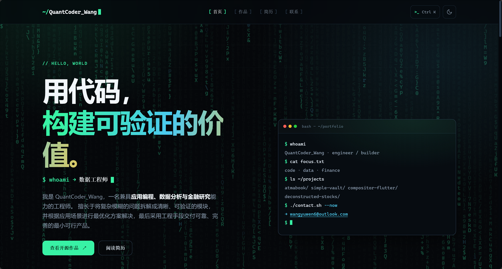

# personalwebpage

这是一个**纯静态、零构建、零依赖**的极客风格个人主页模板：暗色终端视觉 + 亮色切换，内置个人简历、开源作品图文展示与联系方式，将同时部署到 **GitHub Pages** 与 **Gitee Pages**。



---

## 特性

- **零构建**：原生 HTML5 + CSS3 + ES2020 JavaScript，无 npm 依赖、无 CDN、无外部字体，双击 `index.html` 即可预览。
- **多页面**：首页 `index.html`、作品集 `projects.html`、简历 `resume.html`、`404.html`。
- **内容与页面分离**：作品、社交链接、邮箱等集中在 [`assets/js/data.js`](assets/js/data.js)，改一处即可同步全站。
- **极客交互**：矩阵雨背景、打字机身份轮播、终端式自我介绍、命令面板（`Ctrl/⌘ + K` 或 `/`）、滚动淡入、Toast 提示。
- **作品集**：关键词搜索 + 标签筛选，首页自动展示 3 个 `featured: true` 的项目。
- **简历**：A4 打印样式（`@media print`），可一键打印 / 导出 PDF。
- **可访问性与克制**：跳转主内容链接、`aria-*` 标注、键盘可达；所有动效尊重 `prefers-reduced-motion`，背景动效可在页脚关闭并记忆。
- **双平台友好**：全部相对路径，兼容 GitHub Pages 的 `/repo/` 子路径；不依赖任何境外资源，国内访问无阻塞。

## 目录结构

```
personalwebpage/
├── index.html              # 首页：Hero / 关于 / 能力 / 精选作品 / 经历 / 联系
├── projects.html           # 作品集：搜索 + 标签筛选
├── resume.html             # 简历：支持打印 / 导出 PDF
├── 404.html                # 终端风格 404
├── assets/
│   ├── css/
│   │   ├── base.css        # 设计令牌（颜色/字体/间距）与通用元素
│   │   ├── layout.css      # 页头、Hero、区块、页脚、响应式
│   │   ├── components.css  # 作品卡、筛选、命令面板、Toast、简历、404
│   │   └── print.css       # 简历打印样式（仅 resume.html 引入）
│   ├── js/
│   │   ├── data.js         # ★ 站点内容数据（主要编辑入口）
│   │   ├── main.js         # 主题 / 导航 / 动效 / 命令面板 / 数据绑定
│   │   └── projects.js     # 作品卡渲染、首页精选、搜索筛选
│   ├── img/
│   │   ├── favicon.svg
│   │   ├── avatar.svg      # 简历头像占位
│   │   ├── og-cover.svg    # 社交分享图占位
│   │   └── projects/*.svg  # 6 张作品封面占位（800×500）
│   └── resume.pdf          # 简历 PDF 占位（由 resume.html 打印生成）
├── docs/
│   ├── PLAN.md             # 编写规划
│   ├── CONTENT.md          # ★ 内容替换指南
│   └── DEPLOY.md           # ★ GitHub / Gitee 部署步骤
├── .github/workflows/pages.yml   # GitHub Pages 自动部署（可选）
├── .nojekyll               # 关闭 Jekyll 处理
├── robots.txt
├── sitemap.xml
└── LICENSE
```

## 本地预览

任选一种：

```bash
# 方式一：直接双击 index.html（file:// 协议，功能完整）

# 方式二：Python（推荐，路径行为与线上一致）
python -m http.server 8765
# 打开 http://127.0.0.1:8765/

# 方式三：Node
npx serve .
```

## 快捷键

| 按键 | 作用 |
| --- | --- |
| `Ctrl / ⌘ + K` | 打开 / 关闭命令面板 |
| `/` | 打开命令面板（输入框聚焦时不触发） |
| `↑` `↓` `Enter` | 在命令面板中选择并执行 |
| `Esc` | 关闭命令面板 / 移动端菜单 |

## 部署

- **GitHub Pages**：分支部署（Settings → Pages → Deploy from a branch）或使用 `.github/workflows/pages.yml` 自动部署。
- **Gitee Pages**：推送后在仓库「服务 → Gitee Pages」手动部署 / 更新。

详细步骤、自定义域名与常见问题见 [`docs/DEPLOY.md`](docs/DEPLOY.md)。

## 浏览器支持

面向现代浏览器（Chrome / Edge / Firefox / Safari 近两年版本）。使用了 `IntersectionObserver`、`matchMedia`、CSS 自定义属性与 `clamp()`；不支持的旧浏览器会退化为无动效的静态页面，内容仍然可读。

## 许可

[MIT](LICENSE)。模板可自由使用与修改，替换占位内容后即可作为你的个人主页。
